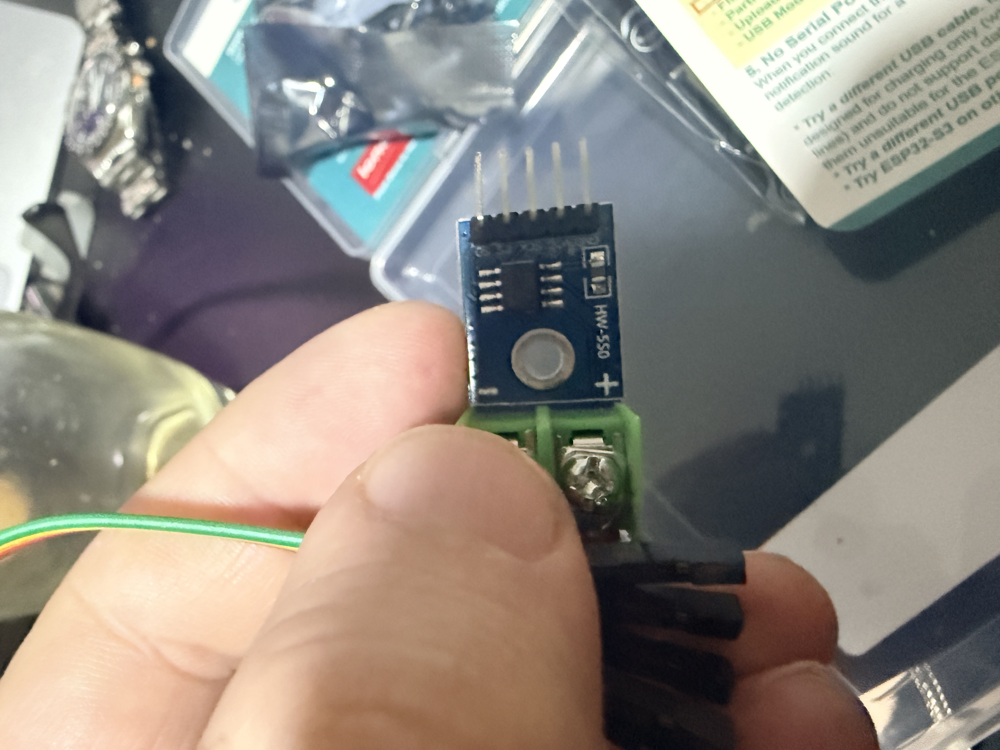
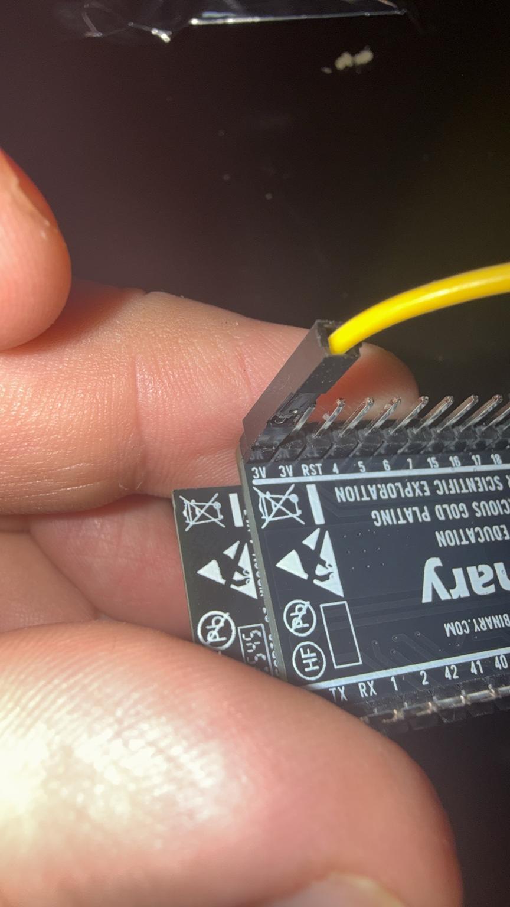
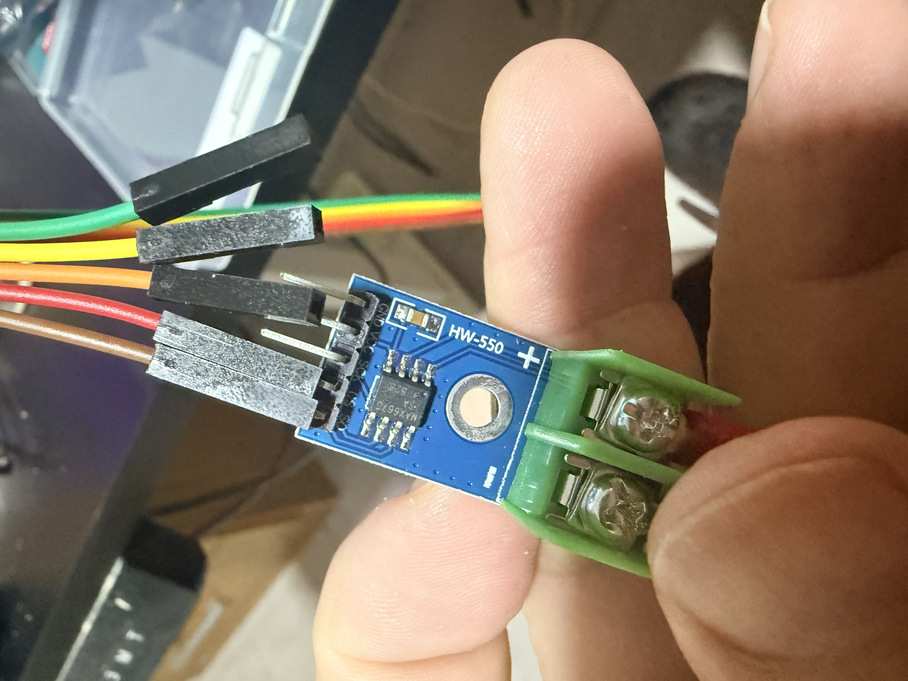
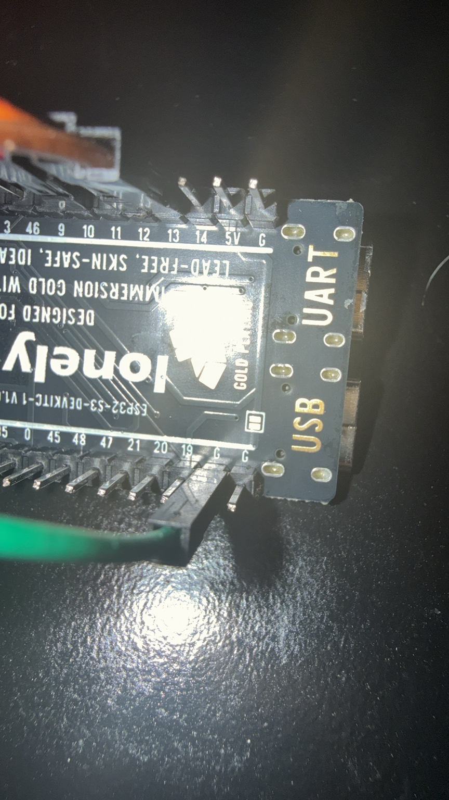
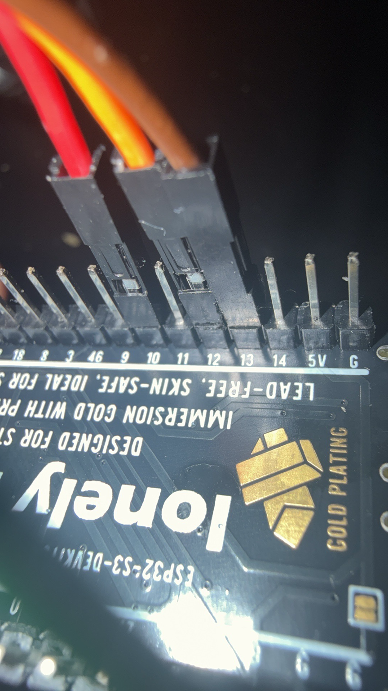

# Instalación física

Las fotos muestran el conexionado que se dejó instalado. Para confirmar cada señal, usa las etiquetas impresas de las placas y no solo el color del jumper:

## Cableado previsto

| Señal | HW-550 / MAX6675 | ESP32-S3 | Cable anotado |
|---|---|---|---|
| SO | SO | GPIO13 | Marrón |
| CS | CS | GPIO10 | Rojo |
| SCK | SCK | GPIO12 | Naranja |
| VCC | VCC | 3V3 | Amarillo |
| GND | GND | GND | Verde |

Alimentar el módulo desde 3V3, no desde 5V, para que las salidas no excedan el nivel permitido por el ESP32-S3. Antes de tocar bornes o jumpers, desconectar el USB. No cambiar pines hasta verificar etiqueta a etiqueta.

## Referencias fotográficas

Vista general de los jumpers en la placa ESP32-S3:

Detalle de las posiciones GPIO visibles en la placa ESP32-S3:

Detalle adicional de las conexiones en el ESP32-S3:

Conexiones en el módulo HW-550; el orden debe confirmarse leyendo la serigrafía junto a cada pin, ya que el ángulo y el foco de la foto no permiten certificar cada jumper por color:

Vista del lado del conector de termocupla:

Otra vista general del módulo y las conexiones:

## Validación pendiente

La última prueba del firmware indicó termocupla abierta. En las fotos no puede certificarse la continuidad de la termocupla ni que los conductores estén correctamente sujetos dentro de los bornes verdes. Con el USB desconectado, confirma que la termocupla esté insertada y apretada en los dos bornes marcados para termocupla y que los jumpers correspondan a las etiquetas de señal. No cortocircuites esos bornes ni intercambies conexiones por suposiciones.

El ESP32-S3 se instalará dentro del gabinete y se informó acceso a los conectores externos de una fuente ATX de 850 W. El montaje del cooler de 12 V todavía no está realizado: revisar primero los requisitos eléctricos y pendientes en [`docs/cooler/cooler1.md`](../cooler/cooler1.md). La potencia nominal total de la fuente no sustituye la comprobación del riel, conector, cableado y driver concretos.
